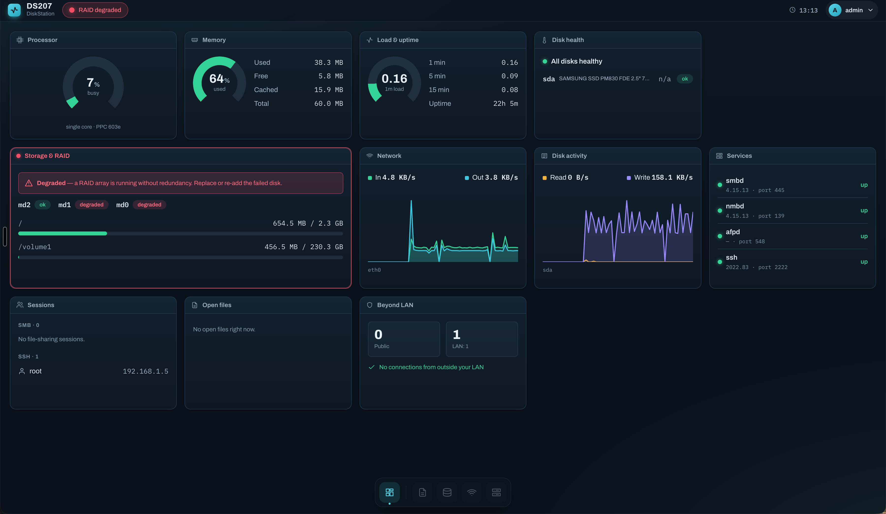

# DS207 Modernization — Deliverables & Install Guide

Modernized network stack for the **Synology DS207 (PowerPC `ppc824x`, DSM 3.1, 64 MB RAM)**:
modern **SMB2/SMB3** file sharing with Apple **`vfs_fruit`** (Finder + Time Machine over SMB),
**mDNS/Bonjour** discovery, and modern **Ed25519 SSH** — so Windows 11, macOS, and Linux
clients can mount shares again.

All binaries are **statically linked (musl)** and were cross-compiled for PowerPC 603e and
verified under QEMU (`qemu-ppc -r 2.6.24`): `smbd -V` / `nmbd -V` / `testparm` report
**Version 4.15.13**, with `vfs_fruit`/`catia`/`streams_xattr` and GnuTLS (SMB3 crypto) built in.

A companion **web monitoring dashboard** (own port `:8181`, read-only, LAN-only) ships as an
optional installer module. It runs alongside the stock DSM UI (which it never touches) and
shows the real-time health of the box — including the modern Samba/SSH stack the stock UI
can't see. See [Monitoring dashboard](#monitoring-dashboard-web-ui) below.



## What's here

| File | Purpose |
|---|---|
| `ds207_patch/ds207_live_patch.sh` | **Recommended installer.** Applies over SSH/Telnet to a running DS207. No reflash, does not touch data drives, fully reversible. |
| `ds207_patch/ds207_modern_payload.tgz` | Static binaries + configs the live-patch installs (keep next to the script). |
| `deliverables/DS207_Modernized_Custom.pat` | Full firmware image for Synology Assistant / DSM Update. **See the checksum caveat below.** |
| `samba/`, `sbin/dropbearmulti`, `configs/` | The built binaries and config files (sources for the above). |
| `scripts/` | The reproducible cross-compile pipeline (Docker + zig + QEMU). |

## Recommended: live-patch over SSH (safe, reversible)

1. Enable SSH on the DS207 (DSM Control Panel → Terminal), then copy both files to the NAS:
   ```
   scp ds207_patch/ds207_live_patch.sh ds207_patch/ds207_modern_payload.tgz admin@<nas-ip>:/tmp/
   ```
2. SSH in and run as root:
   ```
   ssh admin@<nas-ip>
   sudo sh /tmp/ds207_live_patch.sh install
   ```
   It verifies the hardware is really a `ppc824x` DS207, backs up the stock Samba 3.2.8
   (`/usr/syno/sbin/smbd.orig`), installs Samba 4.15.13, reloads Avahi (Finder + Time Machine),
   and starts Dropbear SSH on **port 2222** (stock sshd on 22 is untouched).
3. Test from a client:
   - **Windows 11 / macoS Finder:** connect to `\\<nas-ip>` (or `smb://<nas-ip>`). The DS207
     should appear in the network; Time Machine can target the `TimeMachine` share.
   - **Modern SSH:** `ssh -p 2222 <user>@<nas-ip>`.
4. Check or revert at any time:
   ```
   sudo sh /tmp/ds207_live_patch.sh status
   sudo sh /tmp/ds207_live_patch.sh uninstall     # restores stock DSM 3.1 Samba
   ```

Shares and SMB users: existing DSM accounts keep working (the new smbd reuses the DSM
`smbpasswd` database). Shares for the new smbd are defined in
`/usr/syno/samba/etc/smb.conf` — edit that file to add/point shares at your `/volume1/...` data.

## Full `.pat` image — checksum caveat

`DS207_Modernized_Custom.pat` contains the modernized `hda1.tgz` (stock rootfs + the new
stack, stock smbd kept as `.orig`), with `zImage`/`rd.bin`/`updater` **unchanged** (no
bricking risk). Its `checksum.syno` has correct CRC32 + size for every member, but Synology's
**two extra per-file checksum fields (field4/field5) are not reverse-engineered** — they are
generated by Synology's internal build tool, not reproducible from the device. For the
modified `hda1.tgz` these are set to `0`, so **DSM's updater may reject this `.pat`** if it
validates those fields.

**Use the live-patch for a reliable install.** The `.pat` is provided for completeness and for
use if/when the field4/field5 algorithm is recovered.

## Hardware limits (important)

The DS207 has **64 MB RAM (fixed)** and a 266 MHz single-core PPC. Static Samba 4 is large
(smbd ≈ 24 MB on disk; RSS ≈ 15–25 MB per worker), so expect **~2–3 concurrent SMB sessions**.
`smb.conf` is tuned for low memory (`max smbd processes`, no winbind/AD/printing). This is a
working prototype; a round-2 pass could shrink it further (`-Os`, fewer modules) if needed.

## Monitoring dashboard (web UI)

An optional, read-only monitoring dashboard that runs on its own port (`:8181`) alongside the
stock DSM UI. It is a reversible overlay with the same safety guarantees as the rest of the
project: the stock UI on `:5000` is never modified, and `uninstall` removes it cleanly.

**Architecture (privilege-separated).** Two small static PPC binaries plus a static single-page
app:

- `collector` — runs as root, **never binds a socket**. Loops ~2 s, parses `/proc` and a fixed
  whitelist of tools (`smartctl`, `mdstat`, `smbstatus`, `netstat`), and writes JSON snapshots
  to `ui/state/*.json` with atomic rename. SMART is cached on a 5-minute cadence.
- `uiserver` — drops privilege to `nobody`, listens on `:8181`. Serves the static SPA and the
  pre-written JSON snapshots under `GET /api/*`. Never execs a command, never reads `/proc`,
  never has root — a compromise yields only read-only monitoring JSON. Password login
  (salted SHA-256, cookie session, rate-limited); path-traversal-safe file serving.
- **Vue 3 SPA** (built with Vite on the dev machine; only static `dist/` ships — the NAS never
  runs Node). Built on a self-contained design system (design tokens + component library +
  app shell), self-hosted fonts (no CDN; LAN-only), live charts via uPlot, a fluid CSS-grid
  layout that reflows 4→3→2→1 columns by viewport with no JavaScript, and a dark / light / auto
  theme switcher. Live tiles poll `/api` (~2 s light metrics; SMART/services on their cadence).

The dashboard shows: CPU %, memory, load average, uptime, model/kernel; per-interface network
throughput and disk I/O (live graphs); per-volume storage and RAID/array health; per-disk SMART
health + temperature; connected SMB/SSH sessions and open files; service status with **version
and port** (smbd, nmbd, afpd, ssh); and a beyond-LAN (WAN) connection indicator.

**Install / reach it.**

```
sudo sh install.sh ui          # install the dashboard module (prompts for a dashboard password)
```

Then open `http://<nas-ip>:8181` in a browser on the LAN and sign in (default username
`admin`, password set at install). Control and status:

```
sh /volume1/@modernsmb/bin/modernsmb.sh ui-start      # start collector + uiserver
sh /volume1/@modernsmb/bin/modernsmb.sh ui-stop
sh /volume1/@modernsmb/bin/modernsmb.sh status
```

It is **read-only** (v1 performs no control actions) and **LAN-only** (plain HTTP; do not
port-forward). A dashboard crash never affects Samba — there is no shared watchdog and no
auto-revert coupling. The dashboard is the first phase of a front-end intended to grow,
phase by phase, toward a fuller control panel; the own-port, overlay, stock-untouched design
is chosen so it can grow without ever risking the stock DSM UI.

## Reproducing the build

Everything runs through Docker + [zig](https://ziglang.org) (native arm64 cross-compiler to
`powerpc-linux-musl`) + `qemu-user-static`. See `scripts/`:
`build_deps.sh` (gmp/nettle/libtasn1/gnutls) → `build_samba_static.sh` (Samba 4.15.13) →
`package_pat.sh` (image). Dropbear and the Avahi service files are built/authored separately.
